<!--
  Методи відновлення ОС
  Варіант 6: Система не завантажується — `/scan` — 41 — Описати послідовність дій у WinRE для цього випадку

  Тему, мету й обладнання писати не треба — конвеєр візьме їх із лабораторної.
  Знімки екрана кладіть у assets/, вихідний код — у src/.
  Контрольні питання — лише одного рівня, того, на який захищаєте роботу:
  заголовок «### Достатній рівень», далі «1 Текст питання?» і відповідь.
  Покрокова інструкція — reports/README.md
-->

## Хід роботи

1 Номер індивідуального варіанта – 6.

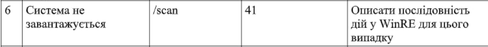

2 На початку лабораторної роботи було запущено віртуальну машину Windows 11 у середовищі Oracle VirtualBox. Для збереження результатів діагностики створено робочий каталог C:\LAB4 та два підкаталоги: Logs для текстових журналів і Screenshots для знімків екрана. У командному рядку з правами адміністратора виконано команди: mkdir C:\LAB4, mkdir C:\LAB4\Logs, mkdir C:\LAB4\Screenshots, dir C:\LAB4. Команда mkdir призначена для створення каталогів. Команда dir відображає їхній вміст і дозволяє переконатися, що каталоги було створено. У результаті виконання команди dir C:\LAB4 підтверджено наявність підкаталогів Logs і Screenshots.

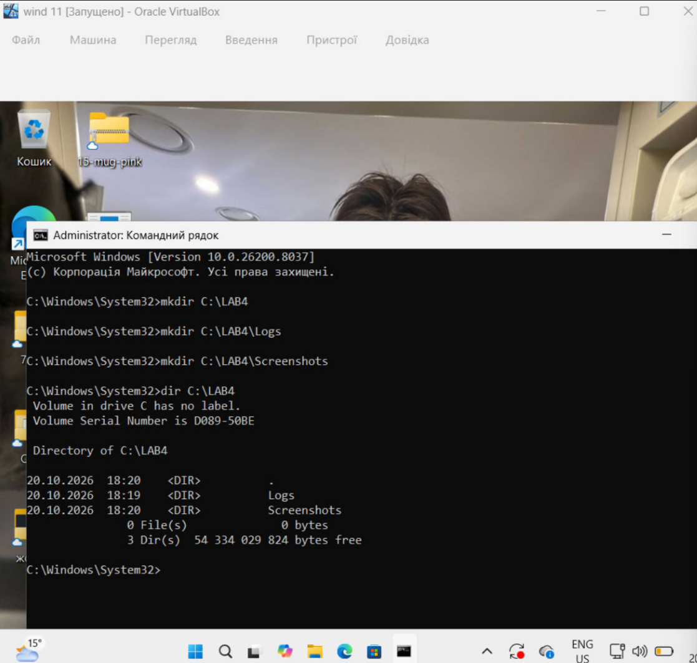

3 Для отримання інформації про встановлену операційну систему використано команду: systeminfo. Команда systeminfo виводить основні характеристики комп'ютера й операційної системи, зокрема назву ОС, її версію, номер збірки, архітектуру, дату встановлення, час останнього запуску та обсяг оперативної пам'яті. За результатами перевірки встановлено, що у віртуальній машині використовується Microsoft Windows 11 Home, версія 10.0.26200, збірка 26200. Час останнього завантаження на момент початкової перевірки становив 20.10.2026 о 17:48:51. Для додаткового підтвердження основних характеристик операційної системи виконано команду PowerShell: Get-CimInstance Win32_OperatingSystem | Select-Object Caption, Version, BuildNumber, LastBootUpTime. Командлет Get-CimInstance отримує відомості про операційну систему через CIM, а Select-Object дозволяє відобразити лише вибрані властивості. Отримані значення підтвердили результати команди systeminfo.

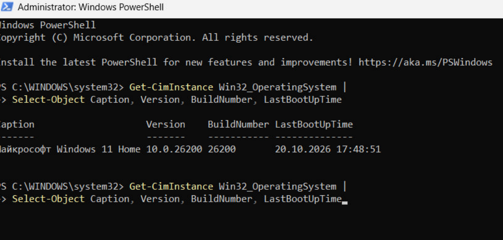

4 Для визначення доступності середовища відновлення виконано команду: reagentc /info. Команда reagentc призначена для керування конфігурацією середовища відновлення Windows, а параметр /info відображає його поточний стан. У результаті отримано: 

5 Для дослідження механізму точок відновлення було відкрито вікно захисту системи за допомогою команди: SystemPropertiesProtection. Ця команда відкриває вкладку властивостей Windows, у якій можна перевірити стан захисту дисків, налаштувати використання дискового простору й керувати точками відновлення. Під час початкової перевірки захист системного диска C: був вимкнений. Для його активації вибрано пункт «Увімкнути захист системи». Максимальний обсяг дискового простору для збереження точок відновлення встановлено на рівні 5%, що становило приблизно 3,95 ГБ. Після застосування налаштувань стан захисту системного диска змінився на ввімкнений. Додатково виконано команду: vssadmin list shadowstorage. Під час початкової перевірки отримано повідомлення: No items found that satisfy the query. Це означало, що команда не виявила налаштованих сховищ тіньових копій на момент перевірки.

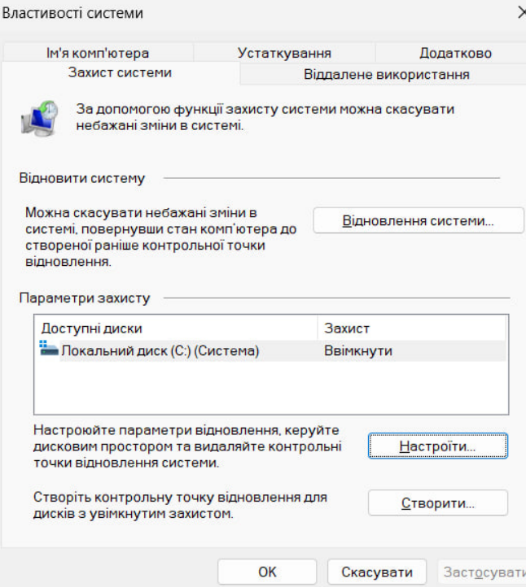

6 Для створення точки відновлення було використано Windows PowerShell із правами адміністратора. Спочатку виконано команду: Enable-ComputerRestore -Drive "C:\". Команда Enable-ComputerRestore вмикає механізм відновлення системи для вказаного диска. Після цього виконано: Checkpoint-Computer -Description "LAB4_Variant6" -RestorePointType "MODIFY_SETTINGS". Команда Checkpoint-Computer створює точку відновлення системи. Параметр -Description задає назву точки, а -RestorePointType визначає її тип. Для перевірки виконано: Get-ComputerRestorePoint | Format-Table SequenceNumber, Description, CreationTime. Команда Get-ComputerRestorePoint виводить доступні точки відновлення, а Format-Table представляє результат у вигляді таблиці. Під час першої перевірки було отримано точку відновлення з описом LAB4_Variant6 та порядковим номером 1. При повторній спробі створення точки Windows повідомила про обмеження частоти створення точок відновлення протягом 1440 хвилин. Пізніше було повторно налаштовано захист системи та виконано перевірку точок відновлення.

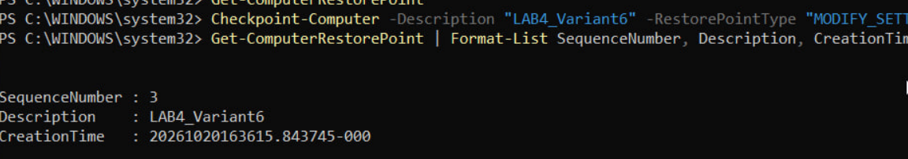

6 Для діагностики сховища компонентів Windows використано утиліту DISM. У командному рядку з правами адміністратора виконано: DISM /Online /Cleanup-Image /ScanHealth. Призначення параметрів: /Online — визначає поточну запущену операційну систему як об'єкт перевірки. /Cleanup-Image — задає операції обслуговування образу Windows. /ScanHealth — запускає детальну перевірку сховища компонентів на наявність пошкоджень. Сховище компонентів Windows містить файли, які використовуються для оновлення, обслуговування та відновлення операційної системи. Перевірка DISM дозволяє встановити, чи потребує це сховище відновлення. За результатами перевірки необхідно враховувати підсумкове повідомлення DISM. Якщо пошкодження не виявлено, додаткове відновлення сховища не потрібне. Якщо сховище пошкоджено, для його відновлення використовують команду: DISM /Online /Cleanup-Image /RestoreHealth. Ця команда може використовувати доступні системні джерела або Windows Update для отримання компонентів, необхідних для відновлення.

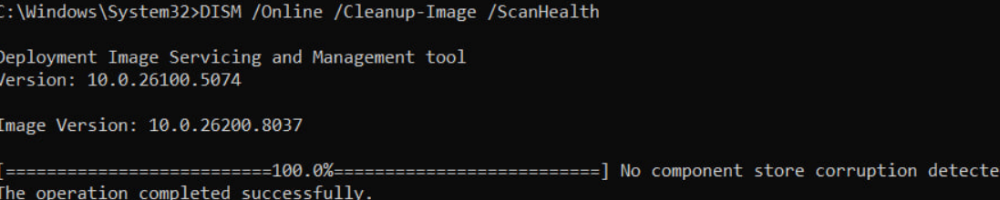

7 Після перевірки сховища компонентів виконано перевірку захищених системних файлів Windows. Для цього використано команду: sfc /scannow. Утиліта SFC (System File Checker) перевіряє цілісність захищених системних файлів та за необхідності намагається відновити пошкоджені файли за допомогою доступних еталонних копій. Параметр /scannow означає виконання повної перевірки захищених системних файлів. Спільне застосування DISM і SFC дозволяє перевірити як сховище компонентів, так і файли, необхідні для нормальної роботи операційної системи.

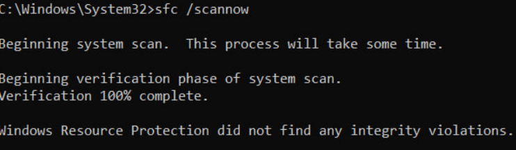

8 Для аналізу результатів перевірки системних файлів використано журнал CBS.log. У командному рядку виконано: findstr /c:"[SR]" "%WinDir%\Logs\CBS\CBS.log" > C:\LAB4\Logs\sfc.txt. Команда findstr здійснює пошук рядків, які містять задану текстову послідовність. Параметр /c:"[SR]" задає пошук записів, пов'язаних із перевіркою SFC. Символ > перенаправляє результат пошуку до текстового файлу. Для перевірки створеного файлу виконано: dir C:\LAB4\Logs\sfc.txt. Для перегляду його вмісту використано: notepad C:\LAB4\Logs\sfc.txt. Збереження журналу дозволяє документувати виконання діагностики та використовувати отримані відомості для подальшого аналізу системних несправностей.

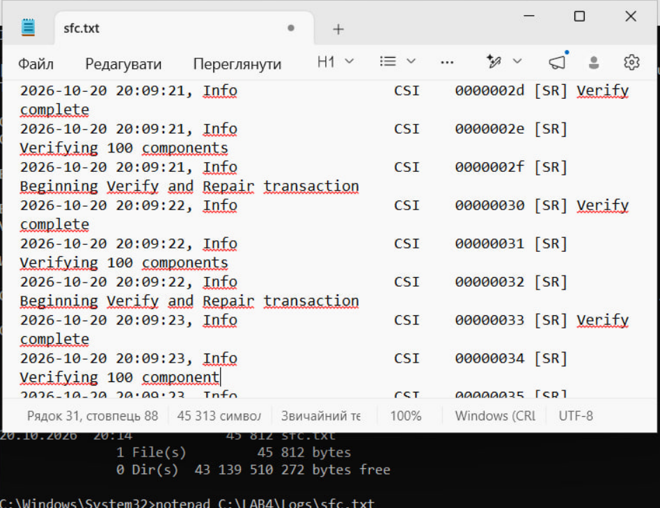

9 Для початкової перевірки файлової системи виконано команду: chkdsk C: /scan. Команда chkdsk призначена для перевірки файлової системи та пошуку її логічних помилок. Параметр /scan використовується для онлайн-перевірки файлової системи NTFS без необхідності попереднього відключення тому.  Для системного тому використання параметра /scan дозволяє виконувати діагностику під час роботи Windows. На відміну від нього, застосування параметра /f для виправлення помилок може потребувати монопольного доступу до системного диска. У такому випадку Windows може запропонувати запланувати перевірку під час наступного перезавантаження. Оскільки індивідуальне завдання передбачає перевірку несистемного тому, подальші дії виконано на додатковому навчальному диску.

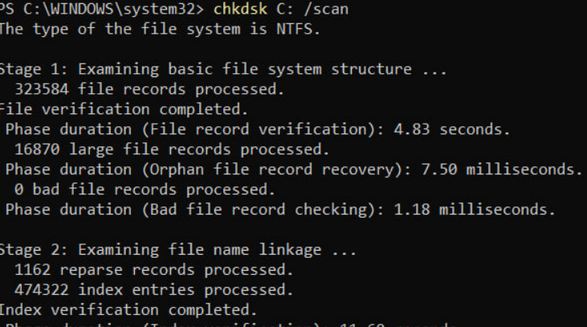

10 Для дослідження доступних дисків використано PowerShell: Get-Volume | Format-Table DriveLetter, FileSystemLabel, FileSystem, Size. Було встановлено, що системний диск C: має файлову систему NTFS. Диск D: мав мітку: CCCOMA_X64FRE_UK-UA_DV9 та файлову систему UDF. Це відповідає підключеному інсталяційному носію Windows. Спроба виконання команди: chkdsk D: /scan не дала необхідного результату, оскільки параметр /scan призначений для перевірки NTFS. Для виконання завдання було створено додатковий віртуальний диск у середовищі Oracle VirtualBox. Після підключення нового диска використано утиліту DiskPart: diskpart, list disk. Команда diskpart запускає засіб керування дисками, а list disk відображає перелік доступних фізичних і віртуальних дисків. Після визначення нового навчального диска на ньому створено розділ із файловою системою NTFS. Для цього використано команди DiskPart. Наведений номер диска 1 відповідає прикладу вибору нового навчального диска; перед виконанням операцій перевірено його фактичний номер і розмір. Команда create partition primary створює основний розділ, format форматує його в NTFS, а assign letter=E призначає новому тому літеру E:. Підготовлений диск E: використано для виконання індивідуального завдання.

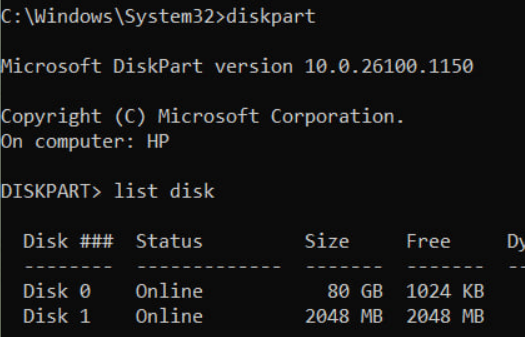
 
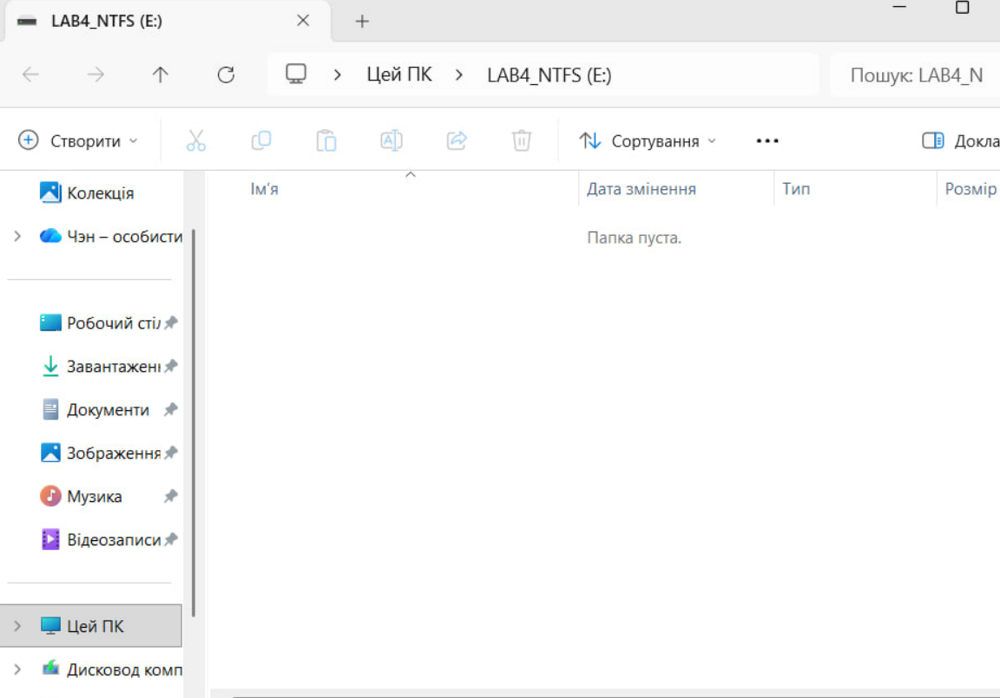

11 Після створення навчального NTFS-розділу виконано команду: chkdsk E: /scan. Команда запускає онлайн-перевірку файлової системи диска E:. Під час перевірки аналізуються службові структури NTFS, зокрема записи файлів, індекси каталогів і пов'язані метадані. Використання додаткового навчального диска дозволило перевірити файлову систему без необхідності змінювати структуру системного тому Windows.

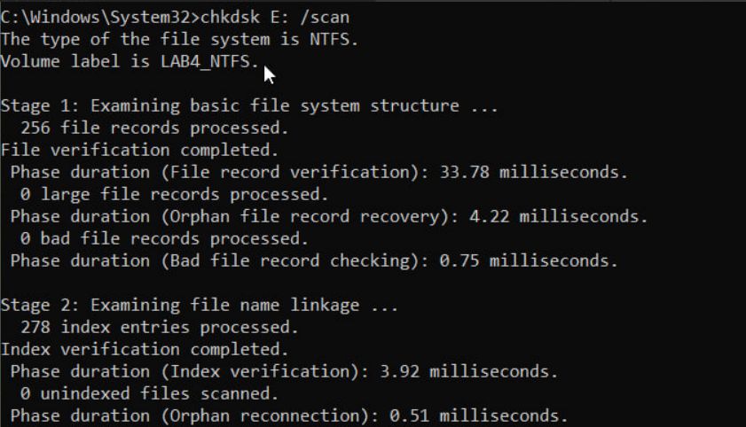

12 Для перевірки реакції утиліти на неправильні вхідні дані виконано команду: chkdsk Z: /scan. Для тестування використано літеру тому Z:, який не був підключений до віртуальної машини. Оскільки вказаний том відсутній, утиліта не може виконати його перевірку та повідомляє про помилку доступу до зазначеного диска. Тестування показує, що для коректного виконання команди необхідно правильно задавати літеру доступного тому та враховувати тип його файлової системи.

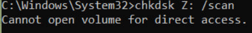

13 Для аналізу роботи операційної системи використано журнал подій Windows. У PowerShell виконано команду: Get-WinEvent -FilterHashtable @{    LogName = 'System'    Level = 1,2    StartTime = (Get-Date).AddDays(-7)} -ErrorAction SilentlyContinue |Select-Object -First 10 TimeCreated, Id, ProviderName, Message |Format-List. Командлет Get-WinEvent дозволяє отримувати записи журналів подій Windows. Параметр LogName='System' задає системний журнал. Параметр Level=1,2 відбирає критичні події та помилки. Вираз (Get-Date).AddDays(-7) обмежує вибірку останніми сімома днями. Команда Select-Object визначає перелік властивостей, які потрібно вивести, а Format-List відображає їх у зручному для аналізу вигляді. Аналіз системного журналу дозволяє виявляти відомості про помилки драйверів, служб, обладнання та інших компонентів операційної системи.

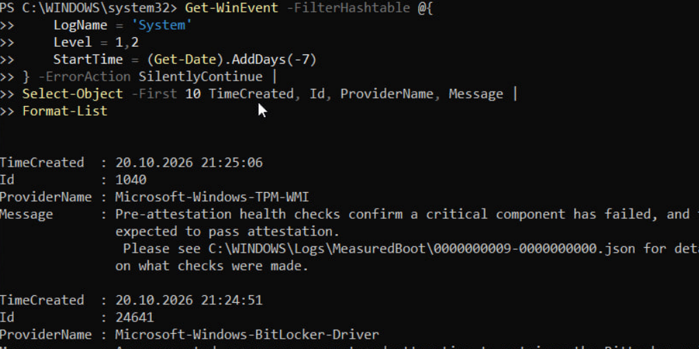

14 Відповідно до індивідуального варіанта № 6 необхідно дослідити системну подію з ідентифікатором 41. Для пошуку виконано команду: Get-WinEvent -FilterHashtable @{    LogName = 'System'    Id = 41} -MaxEvents 10 -ErrorAction SilentlyContinue | Format-List TimeCreated, Id, ProviderName, Message. За результатами пошуку в доступних записах системного журналу подію з ідентифікатором 41 не знайдено. Подія Kernel-Power з ідентифікатором 41 реєструється тоді, коли Windows під час наступного запуску визначає, що попередній сеанс роботи завершився некоректно. Можливими причинами є раптове зникнення живлення, примусове вимкнення комп'ютера, зависання операційної системи або аварійне перезавантаження. Подія 41 сама по собі не визначає точну причину несправності. Для її уточнення необхідно аналізувати інші записи журналу, зокрема події 6008 і 1001, а також додаткові відомості про аварійне завершення роботи. У віртуальній машині Oracle VirtualBox така подія може виникнути, наприклад, після примусового вимкнення живлення віртуальної машини під час роботи Windows. Відсутність події 41 у перевіреному журналі відповідає допустимому результату індивідуального завдання, оскільки методичка передбачає пояснення умов її виникнення, якщо подію не знайдено. 

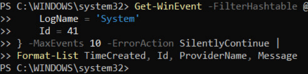

15 Для дослідження способів резервного копіювання створено каталог: C:\LAB4\Source. У командному рядку виконано: mkdir C:\LAB4\Source, mkdir C:\LAB4\Backup. Після цього створено два контрольні текстові файли: echo Laboratory work 4 > C:\LAB4\Source\important.txt, echo Windows 11 recovery test > C:\LAB4\Source\notes.txt. Команда echo виводить текст, а оператор > перенаправляє його до файлу. Наявність файлів перевірено командою: dir C:\LAB4\Source. Створені файли використано для перевірки процесів копіювання, видалення й відновлення даних.

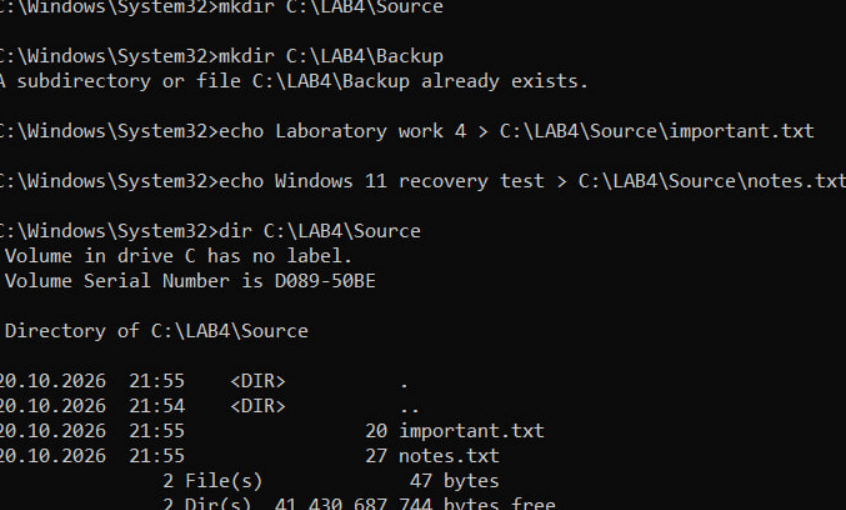

16 Для резервного копіювання навчального каталогу використано системну утиліту ROBOCOPY. Виконано команду: robocopy C:\LAB4\Source C:\LAB4\Backup /E /R:1 /W:1 /LOG:C:\LAB4\Logs\backup.log. Призначення параметрів: /E — копіювання підкаталогів, включно з порожніми; /R:1 — одна повторна спроба копіювання в разі помилки; /W:1 — очікування одну секунду між повторними спробами; /LOG: — запис інформації про виконання команди до текстового журналу. Результат копіювання перевірено командою: dir C:\LAB4\Backup. Резервне копіювання дозволяє зберігати дублікати користувацьких файлів для їх подальшого відновлення в разі випадкового видалення або пошкодження. У навчальному прикладі копію створено на тому самому системному диску. Такий спосіб дозволяє перевірити процес відновлення видаленого файлу, але не захищає від фізичної відмови системного носія. Для надійного резервного копіювання дані потрібно зберігати на окремому фізичному носії або іншому незалежному сховищі.

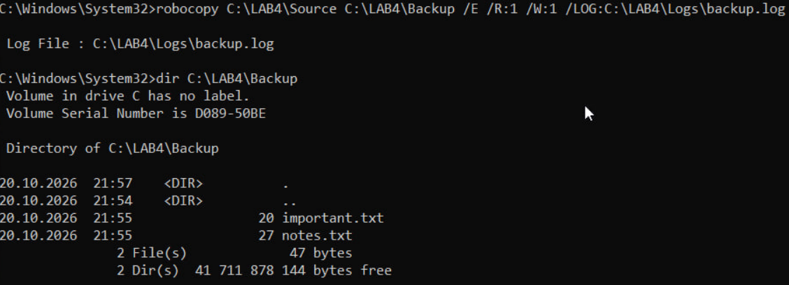

17 Для перевірки можливості відновлення даних виконано видалення одного з контрольних файлів. У командному рядку введено: del C:\LAB4\Source\important.txt. Команда del видаляє зазначений файл. Після цього виконано: dir C:\LAB4\Source. За допомогою команди dir перевірено вміст початкового каталогу після видалення контрольного файлу. Таким чином змодельовано ситуацію випадкового видалення користувацького документа.

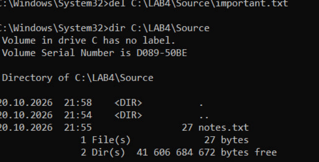

18 Для відновлення видаленого файлу використано команду: robocopy C:\LAB4\Backup C:\LAB4\Source important.txt /R:1 /W:1. У цьому випадку перший шлях визначає каталог резервної копії, другий — каталог, у який необхідно повернути файл, а important.txt задає конкретний файл для копіювання. Після завершення відновлення виконано: type C:\LAB4\Source\important.txt. Команда type виводить вміст текстового файлу безпосередньо в командному рядку. Контрольним вмістом файлу є текст: Laboratory work 4. Відновлення контрольного файлу демонструє практичне застосування резервного копіювання для захисту користувацьких даних від випадкового видалення.

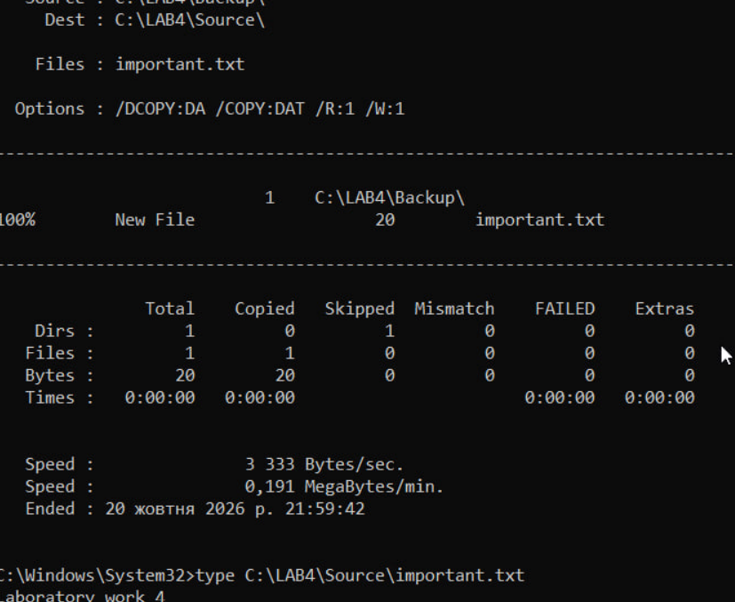

19 Для перевірки реакції утиліти ROBOCOPY на некоректні дані виконано команду: robocopy C:\LAB4\MissingSource C:\LAB4\TestBackup /E /R:1 /W:1. У цьому випадку каталог C:\LAB4\MissingSource не існує. Після запуску команди отримано повідомлення: ERROR 2 (0x00000002) Accessing Source Directory C:\LAB4\MissingSource\ The system cannot find the file specified.Помилка ERROR 2 (0x00000002) означає, що система не може знайти вказаний файл або шлях. Оскільки початковий каталог відсутній, ROBOCOPY не може виконати копіювання. Тестування підтвердило, що утиліта перевіряє доступність каталогу-джерела та повідомляє про неможливість виконання операції, якщо шлях задано неправильно. Таким чином, було досліджено реакцію програми як на коректні, так і на некоректні вхідні дані. 

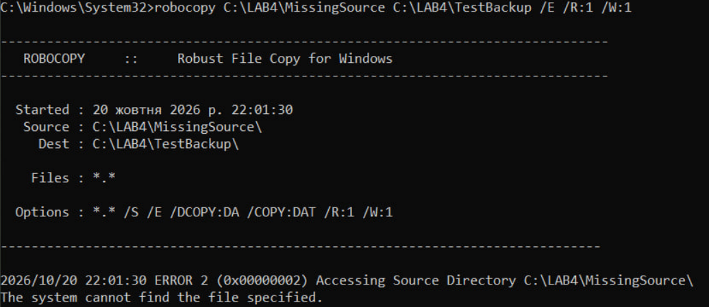

20 Перед виконанням індивідуального завдання, пов'язаного з відмовою завантаження Windows 11, було створено контрольний знімок віртуальної машини Oracle VirtualBox. Знімку присвоєно назву: LAB4_Before_Boot_Failure. Контрольний знімок VirtualBox дозволяє зберегти стан віртуальної машини та за необхідності повернутися до нього. На відміну від точки відновлення Windows, знімок VirtualBox охоплює стан віртуальних дисків і конфігурацію збережених компонентів віртуальної машини відповідно до механізму знімків VirtualBox. Створення такого знімка дозволило зменшити ризик втрати результатів лабораторної роботи під час експерименту.

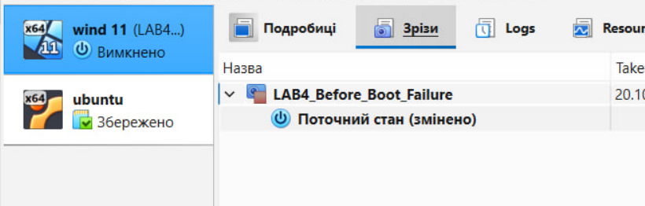

21 Відповідно до індивідуального варіанта № 6 було виконано моделювання ситуації, коли операційна система не завантажується. Для цього в налаштуваннях Oracle VirtualBox тимчасово відключено системний віртуальний диск від контролера. При цьому файл віртуального диска не видалявся, а конфігурація завантажувача Windows не змінювалася. Після зміни конфігурації здійснено спробу запуску віртуальної машини. Під час запуску отримано повідомлення: No bootable option or device was found. Додатково Oracle VirtualBox відобразила повідомлення: The virtual machine failed to boot. Це підтвердило неможливість нормального запуску операційної системи через відсутність доступного завантажувального пристрою. Під час експерименту встановлено, що причиною відмови запуску може бути не лише пошкодження системних файлів або завантажувача, а й неправильна конфігурація віртуального обладнання. У розглянутому випадку застосування DISM, SFC або команд відновлення BCD не було б правильним способом усунення несправності, оскільки система не мала доступу до самого завантажувального диска.

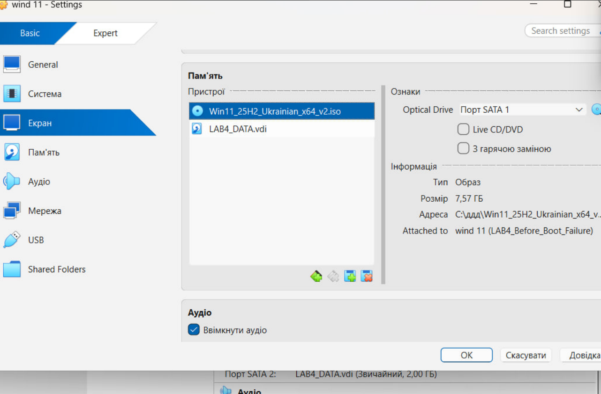

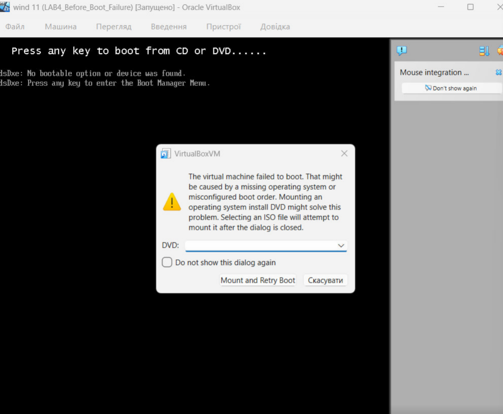

22 Для усунення змодельованої несправності віртуальну машину було вимкнено. Після цього у налаштуваннях Oracle VirtualBox відкрито розділ керування носіями та повторно підключено початковий системний віртуальний диск. Після відновлення підключення здійснено повторний запуск віртуальної машини. Операційна система Windows 11 успішно завантажилася. Отриманий результат підтвердив, що причиною відмови була недоступність завантажувального носія, а не пошкодження самої операційної системи. Таким чином, для заданого сценарію правильним способом відновлення стало повернення початкової конфігурації віртуального обладнання.

23 Після успішного відновлення Windows 11 виконано перевірку конфігурації завантаження. У командному рядку з правами адміністратора використано команду: bcdedit /enum. Утиліта BCDEdit призначена для перегляду та керування параметрами сховища Boot Configuration Data (BCD). Параметр /enum використовується для відображення записів конфігурації завантаження без внесення змін. Для збереження результатів виконано: bcdedit /enum > C:\LAB4\Logs\bcd.txt. Основними елементами конфігурації завантаження є:

Таблиця 1 – Елементи конфігурації завантаження

| Елемент | Призначення |
| --- | --- |
| Windows Boot Manager | Керує вибором і запуском завантажувальних записів |
| Windows Boot Loader | Забезпечує завантаження Windows |
| identifier | Ідентифікатор запису |
| device | Пристрій, пов'язаний із записом завантаження |
| path | Шлях до завантажувального файлу |
| osdevice | Розділ, на якому розташована операційна система |
| systemroot | Системний каталог Windows |

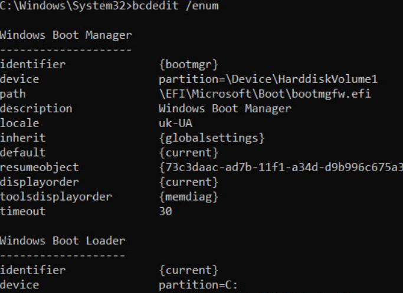

24 Для виконання додаткового завдання варіанта № 6 було досліджено середовище Windows Recovery Environment. Перехід до середовища відновлення виконано за допомогою команди: shutdown /r /o /t 0. Призначення параметрів:

- /r — перезавантаження комп'ютера;
- /o — перехід до меню додаткових параметрів запуску;
- /t 0 — виконання команди без затримки.

Після перезавантаження відкрилося меню середовища відновлення Windows. Для доступу до засобів відновлення вибрано розділ «Пошук і усунення несправностей», а потім «Додаткові параметри». У цьому розділі доступні інструменти діагностики й відновлення операційної системи. Основні засоби WinRE у таблиці. Середовище WinRE дозволяє проводити діагностику навіть у випадках, коли звичайний запуск Windows неможливий. 

Таблиця 2 – Засоби WinRE

| Засіб | Призначення |
| --- | --- |
| Startup Repair | Автоматична діагностика та усунення окремих проблем запуску |
| Command Prompt | Ручна діагностика з використанням команд |
| System Restore | Повернення системи до доступної точки відновлення |
| Uninstall Updates | Видалення оновлень, які могли спричинити несправність |
| Startup Settings | Доступ до додаткових режимів запуску |
| UEFI Firmware Settings | Перехід до налаштувань UEFI |

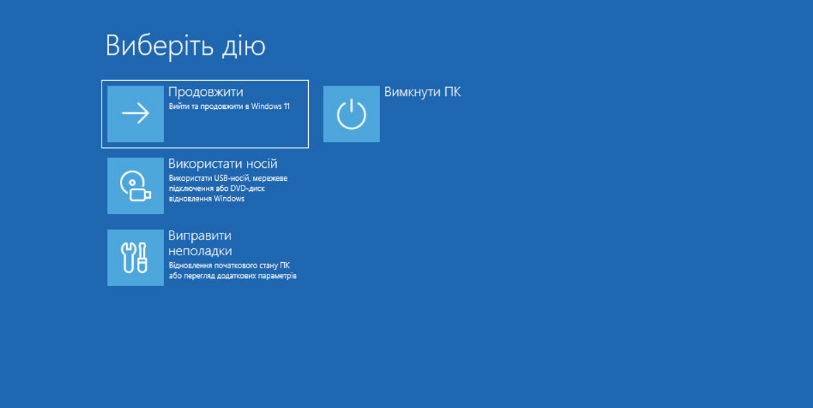

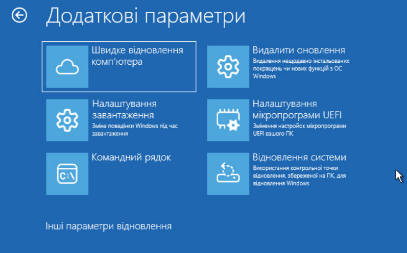

25 Для перевірки дисків і конфігурації завантаження в середовищі WinRE відкрито командний рядок. Після цього виконано: diskpart, list volume, exit. Команда list volume дозволяє визначити наявні томи, їхні літери, розміри та файлові системи. Необхідно враховувати, що в середовищі WinRE літери дисків можуть відрізнятися від тих, які використовуються під час звичайного запуску Windows. Для пошуку встановлених операційних систем використано команду: bootrec /scanos. Команда bootrec /scanos виконує пошук установлених систем Windows. Для перегляду конфігурації завантаження виконано: bcdedit /enum. Команда дозволяє отримати відомості про доступні записи завантаження. Під час виконання лабораторної роботи команди примусового переписування завантажувача не застосовувалися, оскільки несправність було усунуто шляхом відновлення підключення системного диска. Після завершення діагностики виконано вихід із командного рядка та повернення до звичайного завантаження Windows 11.

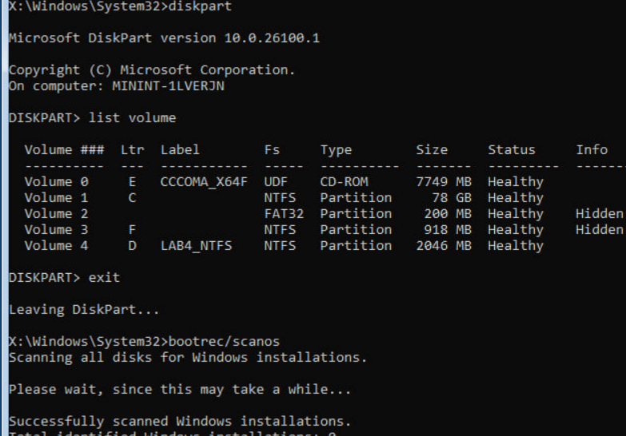

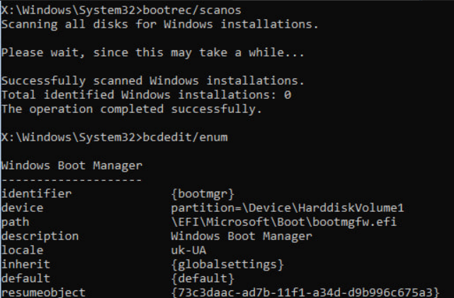

## Додаткове завдання варіанта № 6
Опис послідовності дій у WinRE, якщо операційна система не завантажується.У випадку, коли Windows 11 не завантажується, необхідно послідовно визначити можливу причину несправності та обрати відповідний спосіб її усунення. Перший етап — перевірка доступності завантажувального пристрою. Потрібно переконатися, що системний диск підключений і визначається комп'ютером або віртуальною машиною. У середовищі Oracle VirtualBox необхідно перевірити конфігурацію контролерів, підключення системного VDI-файлу та порядок завантаження. Якщо системний диск недоступний, спочатку потрібно відновити його підключення. Засоби WinRE не можуть виправити відсутність самого завантажувального пристрою. Другий етап — запуск середовища WinRE. Якщо диск доступний, але Windows не запускається, можна перейти до середовища відновлення.Для цього використовують меню додаткових параметрів запуску, інсталяційний носій Windows або штатні засоби автоматичного переходу до відновлення після збоїв завантаження. Третій етап — автоматичне відновлення запуску. У меню WinRE потрібно вибрати: «Пошук і усунення несправностей» → «Додаткові параметри» → «Відновлення запуску».  Інструмент Startup Repair перевіряє наявність окремих проблем, які можуть перешкоджати завантаженню операційної системи. Четвертий етап — перевірка дисків. Якщо автоматичне відновлення не допомогло, необхідно відкрити командний рядок WinRE та виконати: Diskpart, list volume, exit. Ці команди дозволяють визначити доступні розділи та знайти том, на якому встановлено Windows. П'ятий етап — діагностика завантажувача. Для перевірки встановлених систем і конфігурації завантаження можна використати: bootrec /scanos, bcdedit /enum Перша команда виконує пошук установлених систем Windows, друга — відображає записи конфігурації завантаження. У сучасних системах з UEFI результат bootrec /scanos необхідно оцінювати разом з іншими діагностичними даними, оскільки відсутність знайдених записів не завжди означає, що Windows відсутня на диску. Шостий етап — вибір способу відновлення. Якщо несправність виникла після оновлення, можна розглянути видалення останніх оновлень. Якщо проблема пов'язана зі змінами драйверів або системних налаштувань, можна використати відновлення системи до контрольної точки. Якщо підтверджено пошкодження завантажувальних файлів, можуть знадобитися спеціальні засоби відновлення завантажувача. При цьому зміну BCD та завантажувальних розділів потрібно виконувати лише після визначення конкретної несправності. Сьомий етап — контроль результату. Після виконання відновлювальних операцій необхідно перезавантажити комп'ютер і перевірити можливість нормального запуску Windows. У разі успішного завантаження рекомендується перевірити стан системи, доступність дисків і наявність нових повідомлень про помилки. У виконаному практичному експерименті причиною відмови була тимчасова недоступність системного віртуального диска. Після повернення правильного підключення диска Windows 11 успішно завантажилася. Тому застосування команд переписування завантажувача не знадобилося.

Таблиця 3 – Результати виконання

| № | Команда або дія | Умови перевірки | Результат |
|---|---|---|---|
| 1 | reagentc /info | Коректна команда | WinRE увімкнене |
| 2 | Checkpoint-Computer | Створення точки | Початкове створення точки підтверджено |
| 3 | Повторне Checkpoint-Computer | Повтор протягом 1440 хвилин | Попередження про обмеження частоти |
| 4 | chkdsk C: /scan | Системний том NTFS | Онлайн-перевірка успішна |
| 5 | chkdsk D: /scan | Том UDF | Помилка створення знімка тому |
| 6 | chkdsk E: /scan | Навчальний том NTFS | Перевірка успішна |
| 7 | chkdsk Z: /scan | Неіснуючий том | Помилка звернення до тому |
| 8 | Пошук події 41 | Журнал System | Подію не знайдено |
| 9 | ROBOCOPY (правильні шляхи) | Наявні каталоги | Резервне копіювання та відновлення перевірено |
| 10 | ROBOCOPY (неправильний шлях) | Відсутній каталог-джерело | ERROR 2 (0x00000002) |
| 11 | Запуск без системного диска | Змінене підключення VDI | Завантажувальний пристрій не знайдено |
| 12 | Запуск після підключення VDI | Відновлена конфігурація | Windows 11 успішно завантажилася |
| 13 | bcdedit /enum | Перегляд BCD | Виведено конфігурацію завантаження |
| 14 | Команди WinRE | Середовище відновлення | Виконано діагностику дисків і завантажувача |

## Відповіді на контрольні питання

1. Після оновлення драйвера відеокарти система показує синій екран одразу після входу. Опишіть повний порядок відновлення із зазначенням засобу на кожному кроці й поясніть, чому саме в такій послідовності.
Спочатку необхідно запустити Windows у безпечному режимі через WinRE, оскільки він використовує мінімальний набір базових драйверів, що дозволяє уникнути завантаження проблемного ПЗ. Далі в «Диспетчері пристроїв» слід відкотити драйвер відеокарти до попередньої версії або видалити його. Якщо це недоступно, слід скористатися точкою відновлення, створеною до оновлення. Така послідовність є оптимальною, оскільки вона усуває безпосередню причину збою найменш руйнівними для системи методами.

2. Користувач вимагає «щоб усе відновлювалося автоматично». Запропонуйте комбінацію засобів (точки відновлення, образ системи, файлові копії) і обґрунтуйте, від яких саме ризиків захищає кожен з них.
Для надійного захисту слід поєднати три засоби:
* Точки відновлення — захищають від збоїв після встановлення оновлень та драйверів (швидкий відкат системних налаштувань).
* Образ системи — захищає від повного руйнування ОС чи виходу з ладу системного диска (повна копія розділу разом із програмами).
* Резервні копії файлів — захищають від випадкового видалення або пошкодження користувацьких документів.
Створення копій слід автоматизувати за розкладом на незалежний носій.

3. Точка відновлення створена, але відкат не усуває проблему. Назвіть щонайменше три причини, чому так буває, і спосіб перевірити кожну.
* Причина 1: Точку створено вже після виникнення несправності. *Перевірка:* Порівняти дату створення точки з часом появи помилки.
* Причина 2: Проблема спричинена апаратною несправністю або пошкодженням диска. *Перевірка:* Переглянути журнал подій та виконати `CHKDSK`.
* Причина 3: Пошкоджено системні файли або сховище компонентів на глибшому рівні. *Перевірка:* Виконати команди `SFC` та `DISM`.

4. Сформулюйте критерій, за яким адміністратор обирає між відновленням системи і переустановленням з нуля. Оцініть обидва варіанти за часом, ризиком і збереженням даних.
Головний критерій — можливість надійно та швидко усунути несправність зі збереженням наявних даних користувача й програм.
* Відновлення: час зазвичай менший; ризик полягає в тому, що причина збою може залишитися; особисті файли та програми зазвичай зберігаються.
* Перевстановлення: час зазвичай більший; високий ризик втрати даних без попередньої резервної копії; усі програми потребують повторного встановлення.

## Висновок
На лабараторній роботі опанувала штатні засоби діагностики та відновлення Windows: навчилася створювати й застосовувати точки відновлення, перевіряти цілісність системних файлів і сховища компонентів, діагностувати файлову систему, працювати в середовищі відновлення WinRE, створювати резервні копії та знаходити причину збою за журналами подій.
