<!--
  Методи відновлення ОС
  Варіант 9: Аварійне вимкнення живлення — `/f` — 6008 — Пояснити зв'язок подій 6008 і 41

  Тему, мету й обладнання писати не треба — конвеєр візьме їх із лабораторної.
  Знімки екрана кладіть у assets/, вихідний код — у src/.
  Контрольні питання — лише одного рівня, того, на який захищаєте роботу:
  заголовок «### Достатній рівень», далі «1 Текст питання?» і відповідь.
  Покрокова інструкція — reports/README.md
-->

## Хід роботи

1 Зафіксував початковий стан системи: версію та збірку, час останнього завантаження, стан WinRE (reagentc /info), стан захисту системи. Зробив знімок екрана.

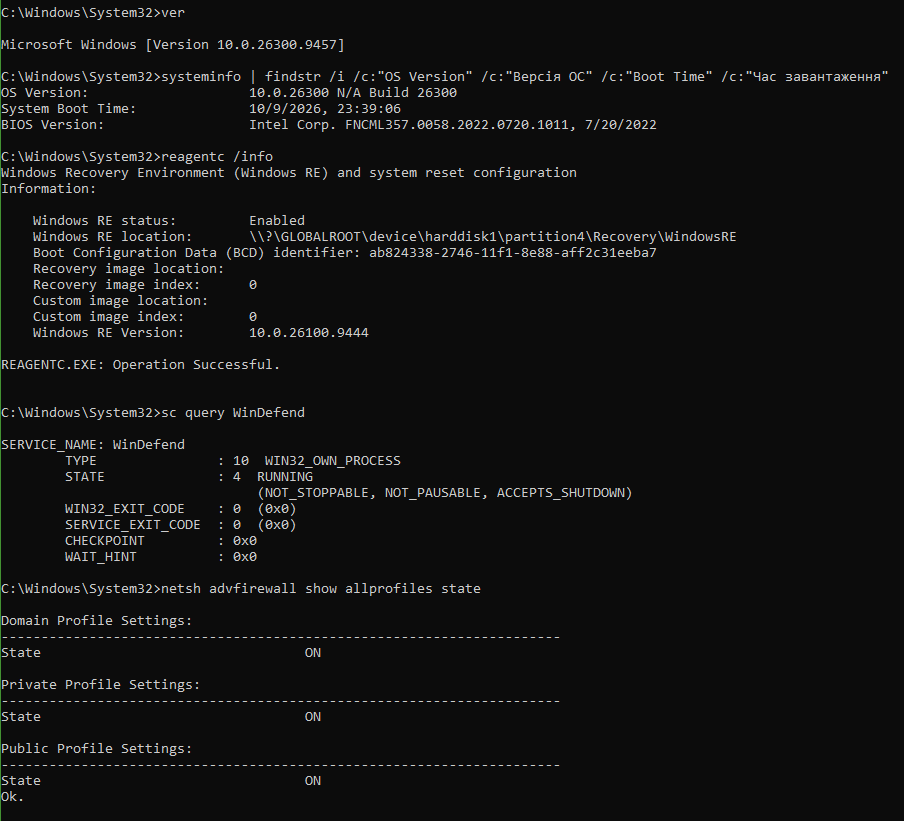

2 Створив точку відновлення з описом, що містить моє прізвище. Вивів перелік точок і зафіксував номер створеної (105).

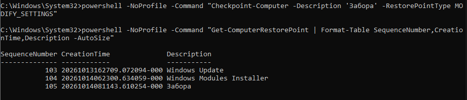

3 Виконав перевірку сховища компонентів (DISM /ScanHealth) і цілісності системних файлів (sfc /scannow) у правильному порядку. Зберіг витяг із журналу CBS у файл на робочому столі.

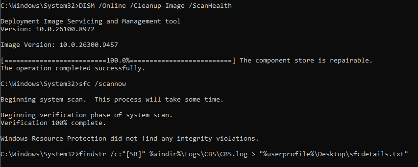

4 Виконав перевірку файлової системи несистемного тому командою chkdsk з ключем свого варіанта. /f виправляє помилки файлової системи, тому йому потрібен ексклюзивний доступ до тому (блокування). Системний том зайнятий працюючою Windows, тож перевірка відкладається до наступного завантаження, коли вона виконується до старту ОС.

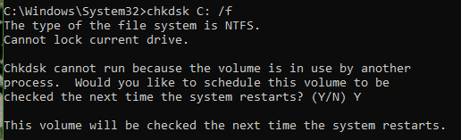

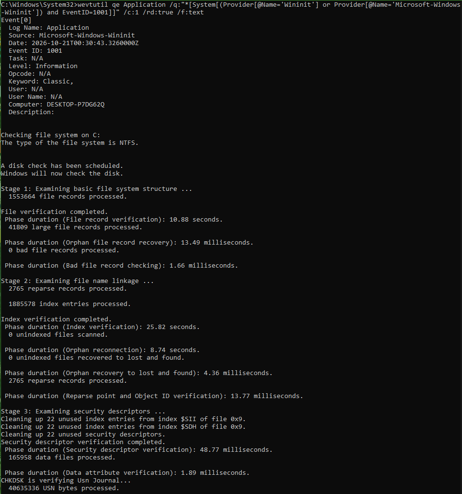

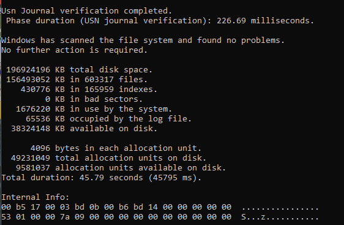

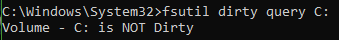

5 Отримав перелік критичних подій системного журналу за останній тиждень засобами PowerShell. Знайшов подію, зазначену у варіанті, подія записується при наступному старті Windows і повідомляє, що попереднє вимкнення було неочікуваним: зникло живлення, натиснули кнопку живлення або скинули ПК, система зависла чи був синій екран. Звичайне завершення роботи її не створює.

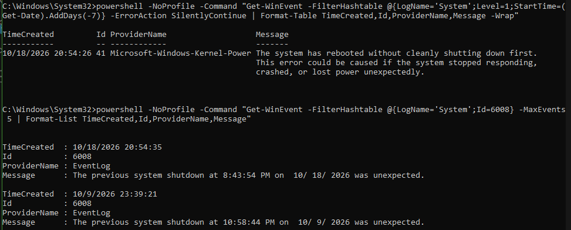

6 Створив резервну копію навчального каталогу командою robocopy, видалив з оригіналу один файл і відновив його з копії. Зафіксував обидві дії.

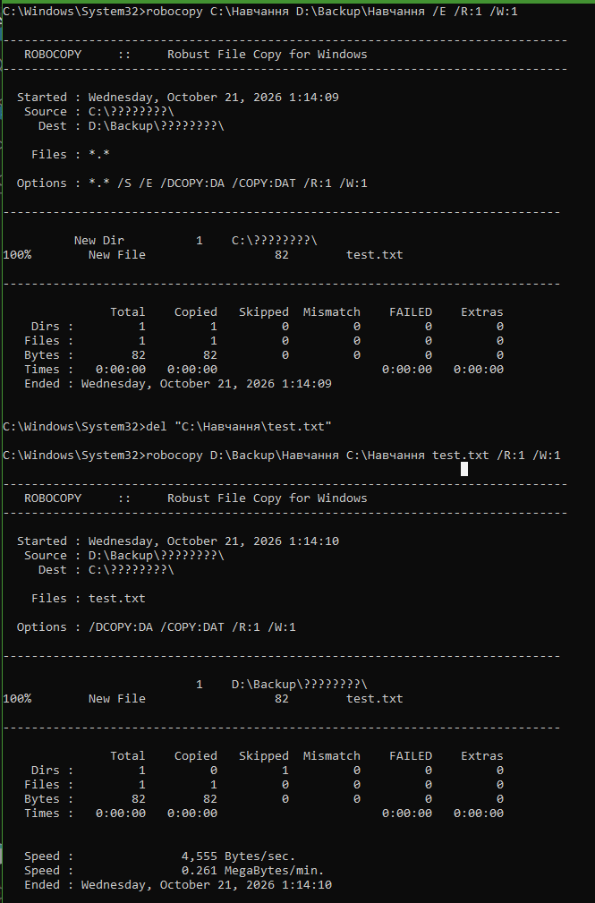

7 Виконав сценарій відмови свого варіанта: змоделював проблему та відновив систему відповідним засобом. У разі аварійного вимкнення живлення запис на диск переривається, тож першим пошкоджується файлова система (журнал і метадані NTFS). Згідно з Таблицею 1, симптомам «помилки читання, зависання дискових операцій» відповідає засіб chkdsk, що змінює саме метадані файлової системи, тому для відновлення обрано chkdsk C: /f. Точка відновлення не підходить, бо вона змінює реєстр, драйвери й системні файли, а не структуру тому. DISM і sfc застосовуються додатково, якщо після chkdsk виявлено пошкодження системних файлів або сховища компонентів. WinRE і bootrec використовуються лише тоді, коли система не завантажується.

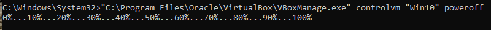

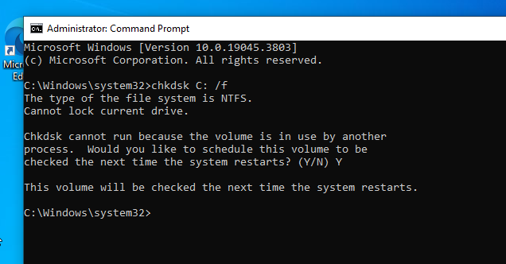

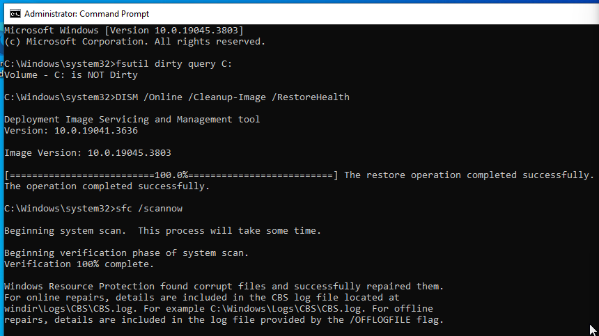

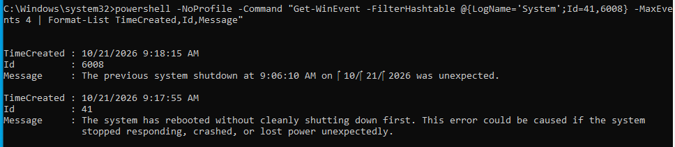

8 Перевірив конфігурацію завантаження командою bcedit /enum. Windows Boot Manager (bootmgr): диспетчер завантаження. Поля: device (розділ із завантажувачем), path, default (запис за замовчуванням), timeout (час очікування вибору). Windows Boot Loader: завантажувач самої ОС. Поля: path (winload.exe або winload.efi), osdevice і systemroot (де лежить Windows), bootmenupolicy.

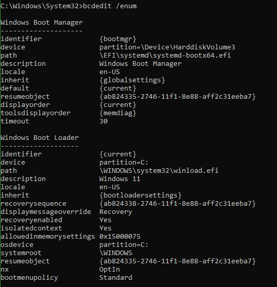

9 41 (Kernel-Power, рівень Critical): система перезавантажилась без коректного завершення роботи. Запис містить BugcheckCode: 0 означає, що синього екрана не було (втрата живлення або жорстке скидання), а ненульове значення вказує на BSOD. 6008 (EventLog, рівень Error): фіксує, що попереднє вимкнення було неочікуваним, і вказує час цього вимкнення. Зв'язок: обидві події описують один інцидент і з'являються разом під час першого завантаження після нього. 41 пояснює, що сталося (джерело: ядро й код збою), а 6008 підтверджує факт і час. Якщо 41 є, а 6008 немає, це може бути збій при виході зі сну або гібернації.

## Відповіді на контрольні питання

### Високий рівень

1 Після оновлення драйвера відеокарти система показує синій екран одразу після входу. Опишіть повний порядок відновлення із зазначенням засобу на кожному кроці й поясніть, чому саме в такій послідовності.

Порядок іде від найм'якшого засобу до найрадикальнішого:
WinRE (автоматично після 2-3 невдалих запусків або Shift + Перезавантаження). Звичайний вхід неможливий, тож потрібне середовище поза ОС.
Безпечний режим (Параметри завантаження → F4). Завантажується мінімальний набір драйверів, тому BSOD не повторюється.
Відкат драйвера (Диспетчер пристроїв → Відкотити) або видалення драйвера. Це точкове виправлення тільки проблемної причини.
Точка відновлення (rstrui), якщо відкат не допоміг. Вона зачіпає реєстр, драйвери й системні файли, тобто ширша зміна.
DISM /RestoreHealth → sfc /scannow, якщо підозра на пошкодження системних файлів.
Скидання або переустановлення як останній засіб.
Чому так: кожен наступний крок вносить більше змін і більший ризик, тому спершу усувають найвужчу причину (драйвер) і лише потім відновлюють загальний стан системи.

2 Користувач вимагає «щоб усе відновлювалося автоматично». Запропонуйте комбінацію засобів (точки відновлення, образ системи, файлові копії) і обґрунтуйте, від яких саме ризиків захищає кожен з них.

|Засіб|Від чого захищає|
|-----|----------------|
|Точки відновлення (автоматично перед змінами)|Невдалі драйвери, програми, зміни реєстру|
|Образ системи (wbadmin, за розкладом)|Відмова диска, неможливість завантаження, повна втрата ОС|
|Файлові копії (Історія файлів, robocopy за розкладом, хмара)|Видалення, пошкодження чи шифрування користувацьких даних|
Копії й образ зберігайте на окремому носії, а не на системному диску: інакше при відмові диска зникне і сам диск, і його копія.

3 Точка відновлення створена, але відкат не усуває проблему. Назвіть щонайменше три причини, чому так буває, і спосіб перевірити кожну.

|Причина|Як перевірити|
|-------|-------------|
|Точка створена після появи проблеми, тому містить уже несправний стан|Порівняти дату точки в rstrui («Показати інші точки») з першим записом про збій у журналі подій|
|Проблема поза охопленням точки: дані, профіль користувача, BIOS, апаратна несправність|Зайти під новим локальним користувачем. Перевірити в безпечному режимі. Виконати chkdsk і перевірити SMART|
|Відновлення не завершилось або не змінило драйвер (захист вимкнено, помилка доступу, антивірус)|Переглянути журнал подій після відновлення. Перевірити reagentc /info і стан захисту системи|

4 Сформулюйте критерій, за яким адміністратор обирає між відновленням системи і переустановленням з нуля. Оцініть обидва варіанти за часом, ризиком і збереженням даних.

Критерій: чи можна за прийнятний час встановити причину і гарантувати довіру до цілісності системи?
Причина відома й усунена → відновлення.
Причина невідома, заражена система або вичерпано DISM + sfc + точка відновлення → переустановлення.
| |Час|Ризик|Збереження даних|
|-|---|-----|----------------|
|Відновлення|	Хвилини, до 1-2 год|Приховані залишкові проблеми, невідомий стан системи|Дані зберігаються|
|Переустановлення|1-3 год плюс програми й налаштування (пів дня)|Втрата даних без резервної копії, чистий стан системи|Лише за наявності копії або режиму «Зберегти файли»|
Практичне правило: виділіть ліміт часу на відновлення (наприклад, 1-2 години). Якщо не вдалося, переходьте до переустановлення. При підозрі на malware чи шифрувальник переустановлюйте одразу, а дані повертайте з перевірених копій.

## Висновок

За роботу було опановано штатні засоби діагностики та відновлення Windows: навчився створювати й застосовувати точки відновлення, перевіряв цілісність системних файлів і сховища компонентів, діагностував файлову систему, працював в середовищі відновлення WinRE, створював резервні копії та знаходив причину збою за журналами подій.